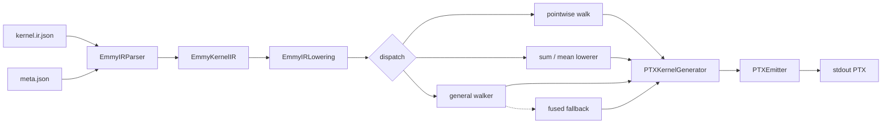

<div align="center">

# Emmy IR → PTX

**A compiler from Emmy Kernel IR to NVIDIA PTX.**

It reads a scheduled kernel, walks the statement tree, and writes PTX to stdout — no CUDA C++, no `nvcc`.

[](#getting-started)
[](#compiler-architecture)
[](#compiler-architecture)
[](#correctness-and-validation)
[](LICENSE)
[](https://github.com/cloudrift-ai/emmy-hackathon-2026)

[Overview](#overview) ·
[Architecture](#compiler-architecture) ·
[How it works](#how-it-works) ·
[Usage](#usage) ·
[Correctness](#correctness-and-validation) ·
[Deep dive](#implementation-deep-dive)

</div>

---

## Overview

[Emmy](https://github.com/cloudrift-ai/emmy) compiles PyTorch expressions to CUDA C++ and builds them with `nvcc`. This project is a submission to the [Emmy Hackathon 2026](https://github.com/cloudrift-ai/emmy-hackathon-2026): write the middle of that pipeline yourself.

`compile.py` takes Emmy's **Kernel IR** and emits **PTX** directly. `ptxas` then assembles the same GPU binary. The hackathon brief notes that this path is about 19× faster than a full `nvcc` compile — Emmy's autotuner compiles thousands of kernel variants, so that middle step matters. That 19× figure is Emmy's, not a measurement from this repository.

The compiler does not need a GPU. A hosted runner at `http://runner.riftstack.ai:48701` assembles the PTX, launches it under each problem's `meta.json` geometry, and checks the outputs.

```bash
python compile.py problems/p00_scalar_add/k_add_pointwise.ir.json > out.ptx
```

---

## Key highlights

- **Submission contract.** One file, one argument, PTX on stdout: `python compile.py <kernel.ir.json>`.
- **IR, not strings.** Bodies deserialize through `emmy-ml==0.3.11` (`Graph.from_dict`). The compiler walks typed statements.
- **Launch is metadata.** Grid, block, shared-memory bytes, and `arg_order` come from `meta.json`, not guessed from the IR.
- **Two lowering styles.** Straight-line pointwise and cooperative reductions have dedicated lowerers. Fused, matmul, and attention kernels go through a general statement walker first; the specialized fused lowerers remain as fallback.
- **Public open set.** All 15 published problems pass the official runner. That is not a hidden-set result.

---

## Compiler architecture



| Stage | Class | Role |
| --- | --- | --- |
| Parse | `EmmyIRParser` | Load the JSON graph with Emmy, require `meta.json`, check entry name and `arg_order`. |
| Validate | `EmmyKernelIR` | One `KernelOp`, f32 buffer arguments, launch record attached. |
| Allocate | `PTXKernelGenerator` | Virtual registers, parameter symbols, shared arrays, instruction list. |
| Lower | `EmmyIRLowering` | Walk the body; emit one translation per statement kind. |
| Emit | `PTXEmitter` | `.version 8.0` / `.target sm_89` / `.address_size 64`, then the entry. |

`ptxas` does the real register allocation. This compiler hands out fresh virtual registers (`%f`, `%r`, `%rd`, `%p`) and declares the counts at the top of the entry.

---

## How it works

Every problem folder has the same three views of one kernel:

| File | Role |
| --- | --- |
| `*.ir.json` | Compiler input |
| `*.ir.txt` | The same IR, pretty-printed |
| `meta.json` | Launch geometry and argument order |
| `*.ref.cu` | Emmy's CUDA C++ reference — a different target language |

`problems/p00_scalar_add` is a 128-element add, tiled over 64 cells with two values per cell. The launch is 256 threads; extra lanes are gated by the tile extent, which is **not** in the IR.

```text
Tile[a0] (N=64)
    in0__u0 = load x0[((a0 * 2) + 0)]
    in1__u0 = load x1[((a0 * 2) + 0)]
    f32 v0__u0 = add(in0__u0, in1__u0)
    ...
    add[((a0 * 2) + 0)] = (v0__u0, v0__u1)
```

The compiler emits PTX of this form (abbreviated from a real `compile.py` run):

```ptx
.version 8.0
.target sm_89
.address_size 64

.visible .entry k_add_pointwise(
    .param .u64 param_x0,
    .param .u64 param_x1,
    .param .u64 param_add
)
{
    ld.param.u64 %rd0, [param_x0];
    ld.param.u64 %rd1, [param_x1];
    ld.param.u64 %rd2, [param_add];

    mov.u32 %r0, %tid.x;
    mov.u32 %r1, %ctaid.x;
    mov.u32 %r2, %ntid.x;
    mul.lo.u32 %r3, %r1, %r2;
    add.u32 %r4, %r3, %r0;         // linear thread id
    setp.ge.u32 %p0, %r4, 64;      // Tile N = 64; launch is 256 threads
    @%p0 bra L_pointwise_end_1;

    mul.wide.u32 %rd3, %r8, 4;     // element index -> byte offset
    ld.global.f32 %f0, [%rd4];     // Load x0
    ld.global.f32 %f1, [%rd6];     // Load x1
    add.f32 %f2, %f0, %f1;         // Assign add
    st.global.f32 [%rd12], %f2;    // Write
    ret;
}
```

A reduction such as `r01_array_sum` adds a strided loop, a 32-lane `shfl.sync.bfly.b32` butterfly, a shared-memory tree, and a `bar.sync`. The hand-written walkthrough of that pattern is [`examples/k_sum_1_reduce.ptx`](examples/k_sum_1_reduce.ptx).

---

## Supported kernel families

The open set is 15 problems in five categories. The hidden evaluation set uses the same families with different shapes and ops. Passing the table below does **not** imply hidden-set results.

| Category | Open problems | What the compiler handles |
| --- | --- | --- |
| Pointwise | `p00_scalar_add`, `p01_vector_add`, `p02_scale_shift`, `p03_relu_mul` | `Tile`, scalar `Load` / `Assign` / `Write`, constants as buffer args, extra-thread guard from Tile `N` |
| Reductions | `r01_array_sum`, `r02_big_sum`, `r03_mean`, `r04_row_sum` | `StridedLoop`, `Accum(add)`, `WarpShuffle`, `Smem`, `Sync`, `TreeHalve`; mean divides by a count buffer |
| Fused | `f01_rmsnorm`, `f02_row_softmax`, `f03_l2norm` | General walker (`WarpShuffle` / `TreeHalve` run the IR `combine_states`); specialized lowerers if that path raises |
| Matmul | `m01_matmul_512`, `m02_matmul_rect` | Nested `Loop`, `Init`, `cp.async` (4 / 8 / 16 bytes), shared tiles, atomic `Write` |
| Attention | `a01_attention`, `a02_attention_128` | Softmax fused into a matmul: `Let`, online accumulators, grouped loads |

Elementwise ops implemented in the assign lowerer include add, sub, mul, div, min, max, exp, log, relu, neg, abs, sqrt, rsqrt, reciprocal, square, and copy. Accumulator ops include add, mul, min, and max. Index expressions are `Var`, `Literal`, `BinaryExpr`, `TernaryExpr`, and the `threadIdx.x` / `blockIdx.x` builtins.

---

## Getting started

**Python 3.12 or newer.** Torch and a local GPU are not required to compile or to talk to the runner.

```bash
git clone https://github.com/mematcha/emmy-lowering-ptx.git
cd emmy-lowering-ptx

python3.12 -m venv .venv
source .venv/bin/activate          # Windows: .venv\Scripts\activate
pip install emmy-ml==0.3.11 numpy requests
```

The same pins live in [`pyproject.toml`](pyproject.toml). `emmy-ml` is required to deserialize Kernel IR. Torch is only needed if you generate new IRs with Emmy.

---

## Usage

```bash
# Compiler contract — PTX on stdout, diagnostics on stderr
python compile.py problems/p00_scalar_add/k_add_pointwise.ir.json > out.ptx

# Assemble, run, and check one open problem on the hosted GPU
python submit.py p00_scalar_add --compiler compile.py

# Same pipeline against a hand-written PTX file
python submit.py r01_array_sum examples/k_sum_1_reduce.ptx
```

`compile.py` takes exactly one argument: a `*.ir.json` path. It reads the sibling `meta.json` for `arg_order` and launch. The entry symbol is the kernel's IR name (`k_add_pointwise`, `k_sum_1_reduce`, …). Buffers are `.u64` pointer parameters.

Local unit tests (PTX types, operands, instruction encoding, and lowering) live under [`tests/`](tests/):

```bash
pip install pytest
pytest
```

---

## Correctness and validation

A full pass of the **15 published problems** was recorded against the official runner (`submit.py --compiler compile.py`). Max-abs errors are within each problem's `rtol` / `atol` in `meta.json`.

| Problem | Status | Max abs err |
| --- | --- | --- |
| `p00_scalar_add` | PASS | 0 |
| `p01_vector_add` | PASS | 0 |
| `p02_scale_shift` | PASS | 0 |
| `p03_relu_mul` | PASS | 0 |
| `r01_array_sum` | PASS | 3.815e-06 |
| `r02_big_sum` | PASS | 1.526e-05 |
| `r03_mean` | PASS | 9.313e-10 |
| `r04_row_sum` | PASS | 5.722e-06 |
| `f01_rmsnorm` | PASS | 1.907e-06 |
| `f02_row_softmax` | PASS | 1.490e-08 |
| `f03_l2norm` | PASS | 1.490e-08 |
| `m01_matmul_512` | PASS | 8.392e-05 |
| `m02_matmul_rect` | PASS | 1.144e-05 |
| `a01_attention` | PASS | 6.557e-07 |
| `a02_attention_128` | PASS | 4.470e-07 |

This table is the public open set only. Hidden-set IRs are not in this repository and have not been reported here. Judging also includes code review and kernel speed; those are not claimed.

---

## Implementation deep dive

<details>
<summary>Dispatch, registers, and the two walkers</summary>

`EmmyIRLowering.lower()` loads parameter pointers, then chooses a path from the top-level `Tile` body:

1. The exact sum / mean statement list stays on `_lower_sum_reduction`.
2. Any other body whose kinds are in the general set is sent to `_lower_general`. On `NotImplementedError`, emitter state is restored and the specialized softmax, RMSNorm, or L2 lowerer runs.
3. Remaining `StridedLoop` kernels fall through to the reduction lowerer.
4. Pointwise kernels use the original `Tile` / `Load` / `Assign` / `Write` walk, including the `thread_id < N` guard.

The general walker understands `Load`, `Assign`, `Let`, `Init`, `Accum`, `Loop`, `StridedLoop`, `Cond`, `Sync`, `Smem`, `CpAsyncCopy` / `Commit` / `Wait`, `Write`, `WarpShuffle`, and `TreeHalve`.

`WarpShuffle` requires length 32. Each butterfly mask shuffles every live state through `shfl.sync.bfly.b32`, binds the partners to the IR `state_b` names, and runs `combine_states`. Online softmax therefore merges `(max, sum)` rather than a single add. `TreeHalve` requires a power-of-two length; thread 0 folds shared partials with the same combine program, then a barrier broadcasts slot 0.

A general tile binds `lane = tid & 31` and `warp = tid >> 5` so those names resolve in the IR. Linear thread and block ids are built from `%tid` / `%ctaid` (and `%ntid` / `%nctaid` when the launch is multidimensional). Trailing tile axes must multiply to `prod(block)`; leading axes must multiply to `prod(grid)`.

Shared arrays are static `.shared` declarations, or an `.extern .shared` pool when `meta.json` provides `smem_bytes` large enough for the declared extents.

</details>

<details>
<summary>What is intentionally not in this compiler</summary>

No optimization pipeline, no liveness analysis, no TMA, no `mma.sync` / `wgmma`, no dynamic shapes. Those node kinds are marked unused on the evaluation set in [`TASK.md`](TASK.md). Speed of the generated kernels is a judge tiebreak, not a gate, and this README does not report one.

</details>

---

## Limitations and future work

- **f32 only.** Buffer dtypes other than `f32`, and ranks other than 1-D / 2-D, are rejected at parse/lower time.
- **No tensor-core or TMA path.** `cp.async` is 4, 8, or 16 bytes, without swizzle.
- **Pattern leftover.** Softmax, RMSNorm, and L2 still have specialized lowerers. They no longer hard-code 128 threads, but a hidden kernel whose statement list and launch both miss the walker will still fail closed (`NotImplementedError`) rather than emit wrong PTX.
- **Pointwise vector loads.** The original pointwise `Load` path rejects grouped names; grouped loads are handled on the general path.
- **Hidden set unknown.** Different block sizes, extra elementwise ops, or an unpinned multi-block atomic reduction are the realistic miss modes.

The useful next step is to keep widening the general walker — more ops, more launch shapes — and delete a specialized lowerer only after its open problem still passes through the walker alone.

---

## Repository map

```
compile.py        IR → PTX compiler (the submission)
submit.py         compile + runner + expected.npz check
problems/         15 open problems (IR, meta, reference CUDA, expected outputs)
examples/         commented hand-written PTX for r01_array_sum
tests/            unit tests for PTX types and lowering
docs/API.md       runner HTTP API
docs/LINKS.md     PTX ISA and Emmy links
TASK.md           official node table and CLI contract
MVP.md            official categories 1–2 bar
LICENSE           MIT
```

---

## References

- [Emmy](https://github.com/cloudrift-ai/emmy) — PyTorch-to-CUDA compiler whose Kernel IR this project lowers
- [Emmy Hackathon 2026](https://github.com/cloudrift-ai/emmy-hackathon-2026) — task, open problems, runner
- [NVIDIA CUDA Programming Guide](https://docs.nvidia.com/cuda/cuda-programming-guide/index.html)
- [Parallel Thread Execution (PTX) ISA](https://docs.nvidia.com/cuda/parallel-thread-execution/index.html)
- [PTX ISA 8.0](https://docs.nvidia.com/cuda/archive/12.0.1/pdf/ptx_isa_8.0.pdf) — the version this compiler emits (`.version 8.0`, `.target sm_89`)
- In-repo: [TASK.md](TASK.md), [MVP.md](MVP.md), [docs/API.md](docs/API.md), [problems/PROVENANCE.md](problems/PROVENANCE.md)

---

## Author

[Sathwik Matcha](https://github.com/mematcha) — [mematcha/emmy-lowering-ptx](https://github.com/mematcha/emmy-lowering-ptx)

Built for the Emmy Hackathon 2026. The Kernel IR, problem set, and runner are from [CloudRift / Emmy](https://github.com/cloudrift-ai/emmy).

---

The contribution is a readable IR-to-PTX lowering: one translation per statement kind, launch geometry taken from metadata, and a walker that can follow fused and attention kernels without matching a single open-set skeleton. The public suite is the evidence; the hidden set is the test.
